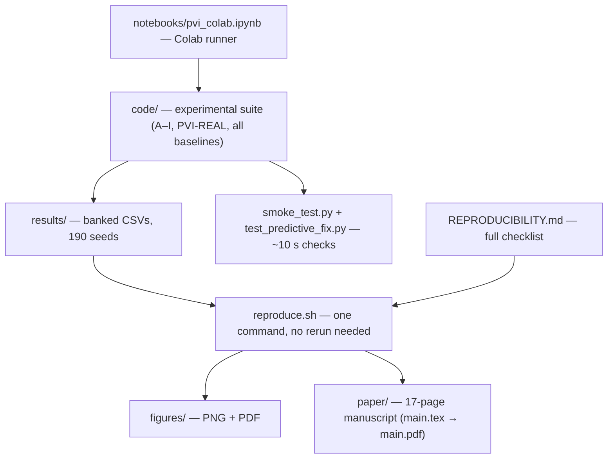

# Provenance-Aware Belief Aggregation in Multi-Agent Communication

> 🐼 New here? Start with the [beginner explainer](EXPLAINED_FOR_BEGINNERS.md) — plain language, one analogy, verified vs not-proved labels.
<p>
  <a href="paper/main.pdf"></a>
  
  
  
</p>

Code and data for the paper *"Provenance-Aware Belief Aggregation in
Multi-Agent Communication Under Convention Heterogeneity"* (Jayant Dubey).

## Overview

Multi-agent systems commonly assume that messages can be aggregated using
source-reliability weights. This assumption fails when sources use different
reporting conventions — mappings from internal readings to messages that can
invert, condition on context, or otherwise transform the underlying signal.

This repository contains:

- Structural limitation theorems (nonnegative-weight insufficiency, scalar
  insufficiency under context-dependent conventions, equal-reliability
  optimum, posterior consistency) and their proofs.
- A finite-grid Bayesian latent-convention aggregator.
- Ten experiments: convention-stability sweep (A), representation ablations
  (B), support-size scaling (C), reliability heterogeneity (D), multi-agent
  consensus (E), LLM communication benchmark (F), real-human-judgment
  CIFAR-10H study, candidate-set misspecification, correlated sources (H) —
  plus the new **Experiment I: the stability boundary**, mapping when
  per-source decoding helps versus hurts — plus **PVI-REAL (§6.13)**:
  controlled panels, CrowdTruth RelEx/RelDir real-convention validation
  with a calibrated decoder, and an adversarial failure map
  (Experiment Pack II).
- All baselines: content-only, unsigned scalar, signed scalar,
  context-conditioned scalar, context-dependent logistic regression
  (CtxLogReg), attention calibrator, mean-pool calibrator,
  EM decoder (MAP point estimate), population-average mapping, Bayesian
  aggregator, and reliability-weighted oracle.
- All headline results banked over **190 seeds** (A: 100; B/C/E: 30 each)
  with 95% confidence intervals, plus a 30-seed ρ×K boundary sweep.

## Final results (17-page manuscript, preprint-ready)

- **Bayes beats the scalar baselines everywhere and matches or exceeds the
  learned calibrators** given identical support — mean ± 95% CI:
  A (ρ=1.0) 0.7576±0.0021; B 0.7590±0.0044; C (K=50) 0.8204±0.0029;
  E (12 agents) 0.9489±0.0114.
- **Multi-agent consensus (12 agents):** +37.5pp over naive averaging,
  within 4.3pp of the oracle.
- **Best learned calibrator reported honestly:** MetaAttn+Dec beats Bayes in
  B by +0.0649±0.0028 (paired, Cohen dz=+8.79).
- **Experiment I — the stability boundary:** at unstable conventions
  (ρ=0.5) a population-average mapping beats per-source Bayesian decoding
  (+0.0196 at K=10, 95% CI [+0.0151, +0.0241], dz=+1.63; the edge shrinks
  with support and vanishes at K=50). At ρ≥0.6 decoding wins decisively
  (−0.2803 at ρ=1.0, dz=−12.74): a sharp, prescriptive boundary on when
  to decode.
- **Calibration:** the Bayesian posterior scores best probabilistically
  (NLL, Brier, ECE) but grows overconfident as conventions stabilise —
  reported as a limitation, not hidden.
- **Real-world anchor:** Sonnet 5.5 on FrontierCode scores *worse* at max
  reasoning effort (46.2%) than one notch below it (52.1%), because
  max-effort multi-agent code review times out or edits out of scope —
  a deployed echo of the paper's noise-not-signal caution.
- **Venue plan:** preprint now (Zenodo DOI), then AAMAS 2027 workshops
  (papers ~24 Jan 2027; conference 3–7 May, Hanoi).

## Quick start

Run from the **repository root** so that `results/` and `figures/` are
created at the top level.

```bash
# One command: regenerate tables, figures and the paper PDF from the
# banked result CSVs — no experiment rerun needed (see REPRODUCIBILITY.md)
bash reproduce.sh

# Install dependencies
pip install -r requirements.txt

# Verify core components (~10 seconds)
python code/smoke_test.py

# Check the posterior-predictive fix against brute-force enumeration
python code/test_predictive_fix.py

# Rerun the experiments: the paper's headline tables use 190 seeds
python code/upgrade_n100.py --only A --seeds 100
python code/upgrade_n100.py --only BCE --seeds 30
# (10-seed subset only: python code/run_all_n10.py)

# Regenerate LaTeX table rows and figures from the CSVs
python code/gen_tables_n100.py
python code/make_figures_n100.py

# Supplementary: decision accuracy conditioned on convention recovery
python code/cond_acc_analysis.py
```

Results are written to `results/*.csv`. Figures are written to
`figures/*.png` and `figures/*.pdf`. The compiled manuscript is at
`paper/main.pdf`; sources are in `paper/sections/`.

## Repository structure

```
.
├── code/
│   ├── pvi_experiments.py     # Full experimental suite (experiments A–G)
│   ├── upgrade_n100.py        # 190-seed headline runs (--only A / --only BCE)
│   ├── run_all_n10.py         # Run the full suite with N_SEEDS=10
│   ├── run_cg_n10.py          # Re-run experiments C–G only (e.g. after an interrupted run)
│   ├── run_B_to_F.py          # Re-run experiments B–F only
│   ├── run_B_only.py          # Re-run experiment B only
│   ├── new_baselines.py       # EMDecoder and BayesSharedR baselines
│   ├── ctxlogreg_baseline.py  # CtxLogReg: per-source context-dependent logistic weights
│   ├── exp_correlated.py      # Experiment H: correlated source errors (independence misspecification)
│   ├── boundary_experiment.py # Experiment I: stability-boundary sweep
│   ├── real_world_cifar10h.py # PVI-REAL: CIFAR-10H real-data study (genuine Dawid–Skene EM)
│   ├── pvi_real/              # PVI-REAL: controlled panels + CrowdTruth studies
│   ├── audit_fixes/           # October 2026 audit-repair experiments (see REPRODUCIBILITY.md)
│   ├── sens_bayes.py          # Grid-resolution and likelihood-temperature sensitivity
│   ├── ci_check.py            # 95% CI checks over the ten seeds
│   ├── cond_acc_analysis.py   # Supplementary: P(correct decision | convention recovery)
│   ├── gen_tables.py          # Generate LaTeX table rows from results CSVs (10-seed)
│   ├── gen_tables_n100.py     # Generate LaTeX table rows from results CSVs (190-seed)
│   ├── make_figures.py        # Figure generation (PNG + PDF)
│   ├── make_figures_n100.py   # Figure generation, 190-seed tables
│   ├── smoke_test.py          # Standalone smoke test
│   └── test_predictive_fix.py # Brute-force test of the posterior-predictive log-odds
├── results/                   # CSVs produced by the suite (banked; reproduce.sh reads these)
├── figures/                   # PNG and PDF figures
├── paper/
│   ├── main.pdf               # Compiled manuscript (17 pages)
│   ├── main.tex               # LaTeX manuscript
│   ├── references.bib         # Bibliography
│   └── sections/              # Section files
├── notebooks/
│   └── pvi_colab.ipynb        # Colab runner
├── reproduce.sh               # One-command artefact regeneration (tables, figures, PDF)
├── requirements.txt
├── environment.yml
├── REPRODUCIBILITY.md
└── README.md
```
Note: `data/` is gitignored on purpose — raw datasets (CIFAR-10H,
ChaosNLI, CrowdTruth) are large and carry their own terms; the scripts
that need them document their source.

## Conventions

The benchmark uses eight involutive conventions:

| ID | Convention            | Context-dependent? |
|----|-----------------------|:------------------:|
| 0  | identity              | No                 |
| 1  | NOT                   | No                 |
| 2  | XOR with a1           | Yes                |
| 3  | XOR with a2           | Yes                |
| 4  | XOR with (a1 AND a2)  | Yes                |
| 5  | XOR with (a1 OR a2)   | Yes                |
| 6  | XOR with (a1 XOR a2)  | Yes                |
| 7  | XOR with NOT (a1 AND a2) | Yes             |

All eight satisfy the involution property f_c(f_c(x, a), a) = x, which the
Bayesian aggregator relies on to recover the underlying reading from an
observed message.

## Reproducing the paper

Fastest path — regenerate every paper artefact from the banked CSVs
(tables, figures, PDF) without rerunning any experiment:

```bash
bash reproduce.sh
```

To reproduce the submitted tables from scratch, run the 190-seed suite
(`code/upgrade_n100.py --only A --seeds 100` and `--only BCE --seeds 30`;
~hours, see REPRODUCIBILITY.md), then `code/gen_tables_n100.py` and
`code/make_figures_n100.py` to regenerate the LaTeX table rows and
figures from the new CSVs. The 10-seed `code/run_all_n10.py` reproduces
a subset only.

Note: `data/` is intentionally not in the repository (raw datasets are
large and redistributed under their own terms). The scripts that need
external data document their source in their docstrings — e.g. the
CIFAR-10H CSV lookup in `code/real_world_cifar10h.py`.

## Reproducibility

- **Randomness:** all sampling uses Python's `random.Random` wrapped in a
  `SafeRNG` class. Each experiment seeds its own RNG via `SafeRNG(seed)` at
  the top of the experiment loop. PyTorch seeds are set via
  `torch.manual_seed(seed)` before every model initialisation.
- **Seeds:** per-experiment seeds 0 through 9.
- **Determinism of the Bayesian aggregator:** the grid over (ρ, r) is
  fixed and enumerated in full. No randomness.
- **Smoke tests:** `python code/smoke_test.py` verifies posterior
  normalization, posterior shape, finite log-odds, binary predictions,
  above-chance accuracy on a clean synthetic case, and RNG reproducibility.
- **Posterior-predictive fix:** `code/test_predictive_fix.py` checks the
  corrected posterior-predictive log-odds against explicit enumeration.
  See REPRODUCIBILITY.md for details of the correction.
- **CUDA nondeterminism:** not required for reproducibility. The suite
  produces the same numbers on CPU and GPU.

See REPRODUCIBILITY.md for the full checklist.

## Compute

- Reference environment: Google Colab T4 GPU
- Peak memory: < 2 GB
- Runtime (10 seeds): ~2 hours on T4, ~5–6 hours on CPU (observed Sep 2026)

## Citation

```bibtex
@inproceedings{dubey2026provenance,
  title={Provenance-Aware Belief Aggregation in Multi-Agent Communication
         Under Convention Heterogeneity},
  author={Dubey, Jayant},
  booktitle={International Conference on Autonomous Agents and Multiagent
             Systems (AAMAS)},
  year={2026}
}
```

## License

MIT. See [LICENSE](LICENSE).

---

## 🗺️ Project map



## 📊 At a glance (verified 30 Oct 2026)

| Measure | Value |
|---|---|
| Paper | Provenance-Aware Belief Aggregation in Multi-Agent Communication Under Convention Heterogeneity (Jayant Dubey) |
| Manuscript | 17 pages, preprint-ready; venue plan: Zenodo preprint, then AAMAS 2027 workshops |
| Core claim | Source-reliability weights fail when sources use different reporting conventions — decode the convention first |
| Method | Finite-grid Bayesian latent-convention aggregator + structural limitation theorems |
| Experiments | Ten: A–I plus PVI-REAL (§6.13, controlled panels + CrowdTruth RelEx/RelDir + adversarial failure map) |
| Seeds | 190 banked (A: 100; B/C/E: 30 each), 95% confidence intervals, plus a 30-seed ρ×K boundary sweep |
| Headlines | A (ρ=1.0) 0.7576±0.0021; B 0.7590±0.0044; C (K=50) 0.8204±0.0029; E (12 agents) 0.9489±0.0114 |
| Consensus | 12 agents: +37.5pp over naive averaging, within 4.3pp of the oracle |
| Stability boundary | At ρ=0.5 a population-average mapping beats per-source decoding; at ρ≥0.6 decoding wins decisively |
| Conventions | 8 involutive mappings (identity, NOT, XOR with a1 / a2 / AND / OR / XOR / NOT-AND) |
| Reproduce | `bash reproduce.sh` regenerates tables, figures, PDF from banked CSVs; full 190-seed rerun takes hours |
| Compute | Reference: Google Colab T4 GPU; peak memory under 2 GB |
| License | MIT |
